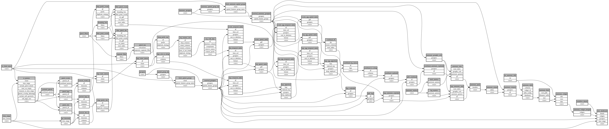

```
# AUTOGENERATED BY ECOSCOPE-WORKFLOWS; see fingerprint in README.md for details

```

```yaml
# fingerprint:
artifacts_sha256_basic: eda7b2ac82a28d0c988f75568b0a6b38a2f91e0bc0ca7508d591ae9bbe4ea12f
artifacts_sha256_strict: 002028a2d4bd11b8fdd12a950912a170c208dd7a87501a4149024ab6167d3ccb
installed_requirements:
- channel: https://repo.prefix.dev/ecoscope-workflows/
  name: ecoscope-platform
  version: {version: ==2.27.1}
- channel: conda-forge
  name: pydeck
  version: {version: ==0.9.2}
params_sha256: df1708f62458abc6541fd52773ee7858ed9ef485eba00cf70f293b4d2ec8b1c2
spec_sha256: 72379dbaba1d1d88717a1891f2dc8b13cde361f83eed787612f12d61146d23ca

```

# ecoscope-workflows-patrol-encounter-rate-stats-workflow


