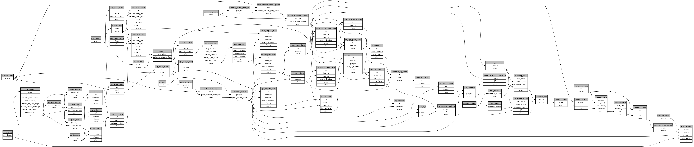

```
# AUTOGENERATED BY ECOSCOPE-WORKFLOWS; see fingerprint in README.md for details

```

```yaml
# fingerprint:
artifacts_sha256_basic: 00e2d8171a70f9254bdc37493f596321aeb3b0c708fa91222c5b1ffb3411cc43
artifacts_sha256_strict: 14e68c26b3d3bfa05fa0fc4536d68975d2c8f64d484f103277288ae1c28872fc
installed_requirements:
- channel: https://repo.prefix.dev/ecoscope-workflows/
  name: ecoscope-platform
  version: {version: ==2.30.1}
- channel: conda-forge
  name: pydeck
  version: {version: ==0.9.2}
params_sha256: df1708f62458abc6541fd52773ee7858ed9ef485eba00cf70f293b4d2ec8b1c2
spec_sha256: aafbaa7b72d03e178de8b5a64608b601af7cc6257ca0469c5d45a1228df8527d

```

# ecoscope-workflows-patrol-encounter-rate-stats-workflow


