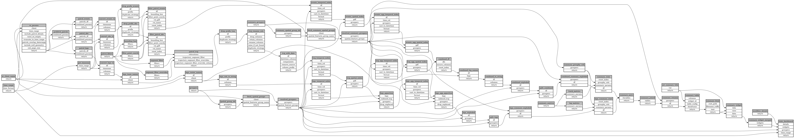

```
# AUTOGENERATED BY ECOSCOPE-WORKFLOWS; see fingerprint in README.md for details

```

```yaml
# fingerprint:
artifacts_sha256_basic: c596c9315ca6ed8d5fb576861994c5f35bc71afc4a768834e6397587e3648c9e
artifacts_sha256_strict: 874c515dc26433aa156f4e26e1c2b8b8e33e773c35cc9f527a41c2520be1465d
installed_requirements:
- channel: https://repo.prefix.dev/ecoscope-workflows/
  name: ecoscope-platform
  version: {version: ==2.39.4}
- channel: conda-forge
  name: pydeck
  version: {version: ==0.9.2}
params_sha256: e0f9b11f2f18488cb37611afa681cac9e54f2c3cb11072689e9012dca8682854
spec_sha256: de2a6c4a2ce031f6640937b0bb72949956ca95a5bbc785560263798844e57e8c

```

# ecoscope-workflows-patrol-encounter-rate-stats-workflow


